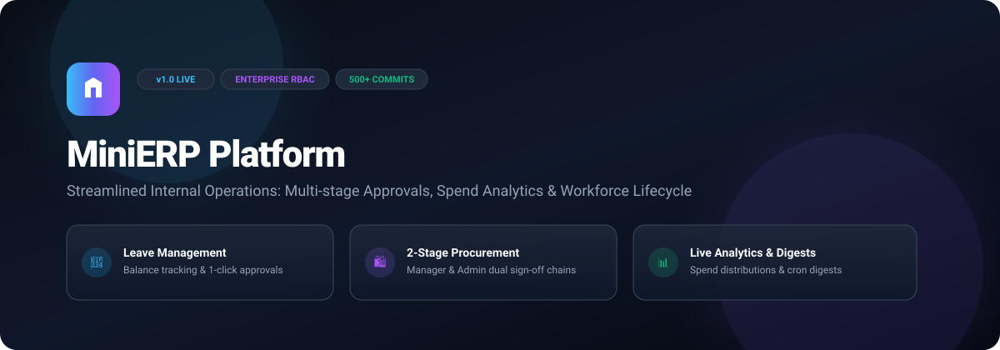
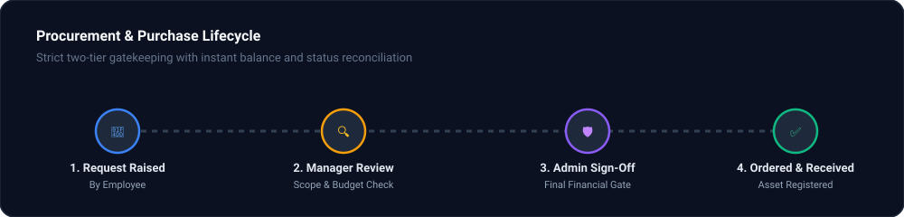
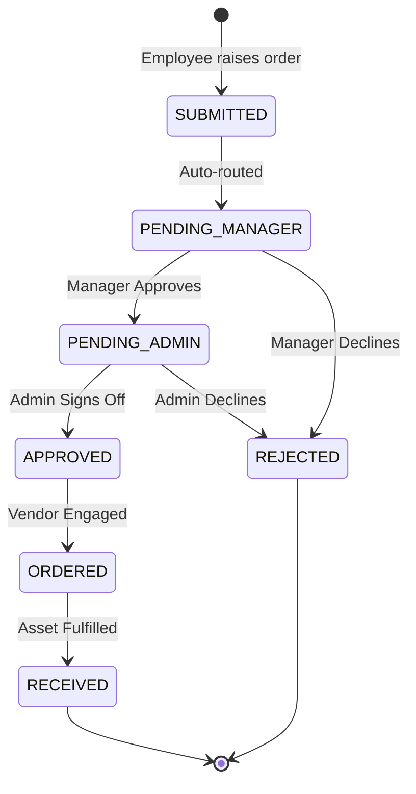
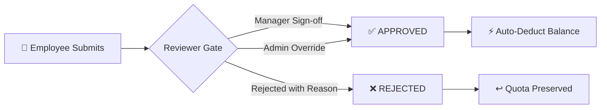
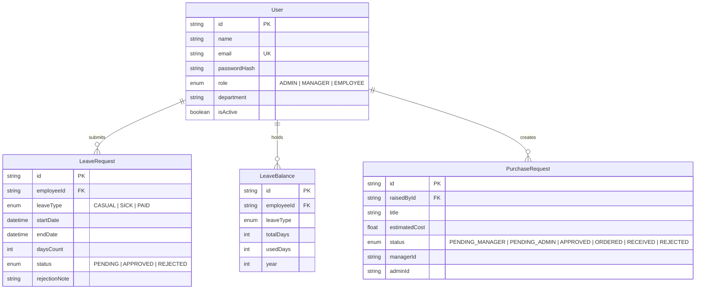

<p align="center">
  
</p>

<p align="center">
  <strong>Enterprise-Grade Internal Operations Platform</strong><br>
  Role-Based Access Control &bull; Multi-Stage Approvals &bull; Leave & Procurement Workflows &bull; Real-time Analytics
</p>

<p align="center">
  <a href="https://mini-erpwebapp.vercel.app"></a>
  <a href="https://minierp-production-31188248.up.railway.app"></a>
  <a href="https://github.com/Anshul-an/MiniERP"></a>
  
</p>

<p align="center">
  
  
  
  
  
  
  
</p>

---

## 📌 Table of Contents
- [✨ Key Highlights](#-key-highlights)
- [🚀 Live Deployments & Demo Access](#-live-deployments--demo-access)
- [🔄 Core Workflows & Architecture](#-core-workflows--architecture)
- [🛠️ Tech Stack](#️-tech-stack)
- [📂 Module Breakdown](#-module-breakdown)
- [🗄️ Database Schema](#️-database-schema)
- [💻 Local Development Guide](#-local-development-guide)
- [📡 API Reference](#-api-reference)
- [🔒 Security & Reliability](#-security--reliability)

---

## ✨ Key Highlights

| Feature | Description |
| :--- | :--- |
| 🛡️ **Role-Based Access Control (RBAC)** | Strictly partitioned views & capabilities for `ADMIN`, `MANAGER`, and `EMPLOYEE`. |
| 🌴 **Leave Operations** | Real-time balance calculations across Casual, Sick, and Paid leave with audit logs. |
| 🛍️ **Two-Tier Purchase Approvals** | Requisitions mandate dual review: Manager operational verification &rarr; Admin financial clearance. |
| 📊 **Executive Analytics** | Recharts spend breakdown, status metrics, and department cost distributions. |
| ⏰ **Automated Digest Daemon** | `@nestjs/schedule` cron tasks generate daily manager summaries and handle monthly balance resets. |

---

## 🚀 Live Deployments & Demo Access

| Tier | Service | URL | Status |
| :--- | :--- | :--- | :--- |
| **Frontend** | Vercel (Edge SPA) | [**https://mini-erpwebapp.vercel.app**](https://mini-erpwebapp.vercel.app) |  |
| **Backend** | Railway (Container) | [**https://minierp-production-31188248.up.railway.app**](https://minierp-production-31188248.up.railway.app) |  |
| **Database** | PostgreSQL | `postgres.railway.internal:5432` |  |

### 🔑 Demo Credentials

The database is pre-seeded. You can use the instant **1-Click Demo Buttons** on the login page or enter credentials manually:

```markdown
┌──────────────┬────────────────────────┬──────────────┬────────────────────────────────────────────────────────┐
│ Role         │ Email                  │ Password     │ Privileges                                             │
├──────────────┼────────────────────────┼──────────────┼────────────────────────────────────────────────────────┤
│ 👑 Admin     │ admin@minierp.com      │ Admin@123    │ Full system access, all approvals, users, analytics    │
│ 👔 Manager   │ manager@minierp.com    │ Manager@123  │ Team leave approvals, stage-1 purchase authorization   │
│ 💼 Employee  │ employee@minierp.com   │ Employee@123 │ Requisitions, personal leave management, status track  │
└──────────────┴────────────────────────┴──────────────┴────────────────────────────────────────────────────────┘
```

---

## 🔄 Core Workflows & Architecture

<p align="center">
  
</p>

### 🛒 Purchase Requisition State Machine


### 🌴 Leave Request Lifecycle


---

## 🛠️ Tech Stack

```
                    ┌────────────────────────┐
                    │      React 18 + Vite   │
                    │   Tailwind + Lucide    │
                    └───────────┬────────────┘
                                │ HTTPS / JWT
                    ┌───────────▼────────────┐
                    │    NestJS REST API     │
                    │ RBAC + Pipes + Cron    │
                    └───────────┬────────────┘
                                │ Prisma ORM
                    ┌───────────▼────────────┐
                    │  PostgreSQL Database   │
                    └────────────────────────┘
```

- **Frontend:** React 18, Vite, TypeScript, Tailwind CSS, Lucide Icons, Recharts, Axios
- **Backend:** NestJS, TypeScript, Prisma ORM, Class-Validator, JWT, Bcrypt, `@nestjs/schedule`
- **Infrastructure:** Railway (Node container + PostgreSQL), Vercel (Frontend CI/CD)

---

## 📂 Module Breakdown

```
MiniERP/
├── backend/
│   ├── src/
│   │   ├── auth/          # JWT strategy, guards, bcrypt hashing
│   │   ├── users/         # User creation, role scoping, directory
│   │   ├── leave/         # Applications, balance deductions, audit logs
│   │   ├── purchase/      # Multi-tier procurement lifecycle
│   │   ├── dashboard/     # Spend distribution, metrics, KPI aggregators
│   │   ├── cron/          # Daily manager email summaries & balance resets
│   │   └── common/        # Global exception filters, pipes, decorators
│   └── prisma/
│       ├── schema.prisma  # Relational models & enums
│       └── seed.ts        # Database seeders with realistic demo records
└── frontend/
    └── src/
        ├── components/    # Modals, timelines, balance cards, navigation
        ├── context/       # Auth state provider & session persistence
        ├── pages/         # Dashboard, Leave, Purchase, Users, Login
        └── lib/           # Clean API client & error transformers
```

---

## 🗄️ Database Schema



---

## 💻 Local Development Guide

### 1. Clone & Prepare
```bash
git clone https://github.com/Anshul-an/MiniERP.git
cd MiniERP
```

### 2. Backend Setup
```bash
cd backend
cp .env.example .env
# Set DATABASE_URL and JWT_SECRET in .env
npm install
npx prisma migrate dev
npx prisma db seed
npm run start:dev
```
Backend will start on `http://localhost:3000`.

### 3. Frontend Setup
```bash
cd ../frontend
cp .env.example .env.local
npm install
npm run dev
```
Frontend will start on `http://localhost:5173`.

---

## 📡 API Reference

### 🔐 Authentication
- `POST /auth/login` &mdash; Authenticates user and returns JWT token & profile
- `GET /auth/profile` &mdash; Returns authenticated user context

### 🌴 Leave Management
- `GET /leave` &mdash; Lists user/department leave requests
- `POST /leave` &mdash; Submits new leave application
- `PATCH /leave/:id/status` &mdash; Approves or rejects request (Manager / Admin)
- `GET /leave/balances` &mdash; Returns current balance metrics

### 🛍️ Purchase Orders
- `GET /purchase` &mdash; Lists scoped purchase requests
- `POST /purchase` &mdash; Creates new purchase requisition
- `PATCH /purchase/:id/status` &mdash; Advances or declines procurement stage

### 📊 Dashboard & Admin
- `GET /dashboard/metrics` &mdash; Returns aggregate spend, pending counts & team stats
- `GET /admin/trigger-digest` &mdash; Manually executes manager summary notifications

---

## 🔒 Security & Reliability

- **Safe Token Handling:** Standard HTTP Bearer headers with cryptographic validation.
- **Data Protection:** Global NestJS exception filter sanitizes internal database and Prisma errors before sending to clients.
- **Input Sanitization:** Strict class-validator white-listing rejects unexpected request payloads.
- **CORS Protection:** Configured to dynamically authorize trusted Vercel production and preview deployment origins.

---

<p align="center">
  Developed by <a href="https://github.com/Anshul-an"><strong>Anshul</strong></a> &bull; Licensed under the <strong>MIT License</strong>
</p>
